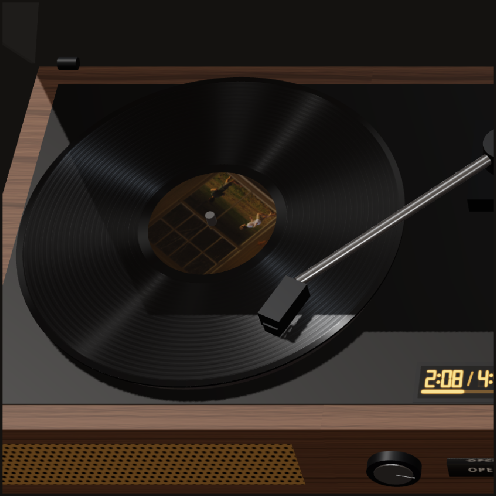
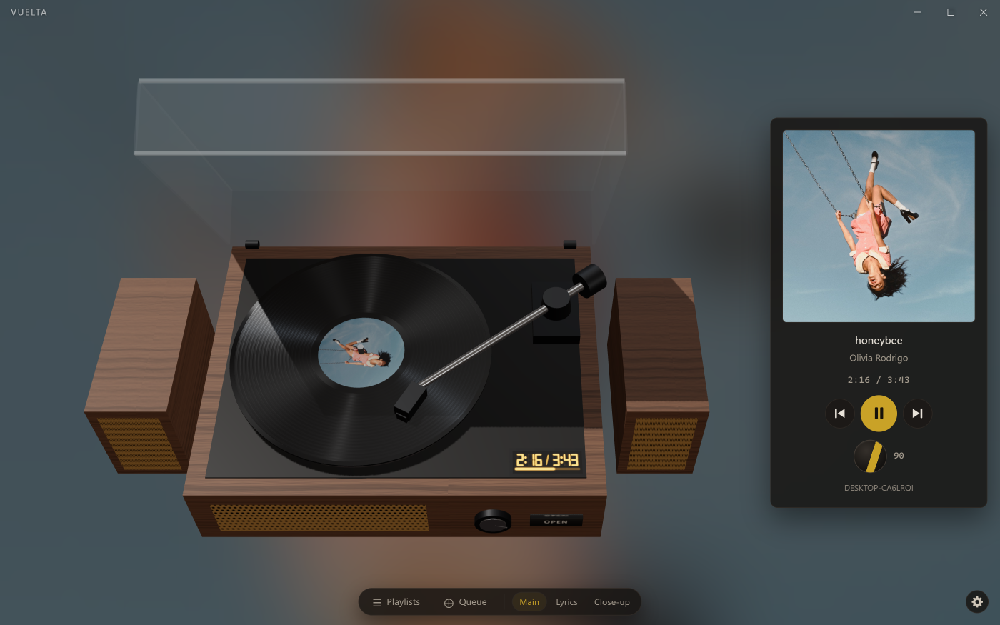
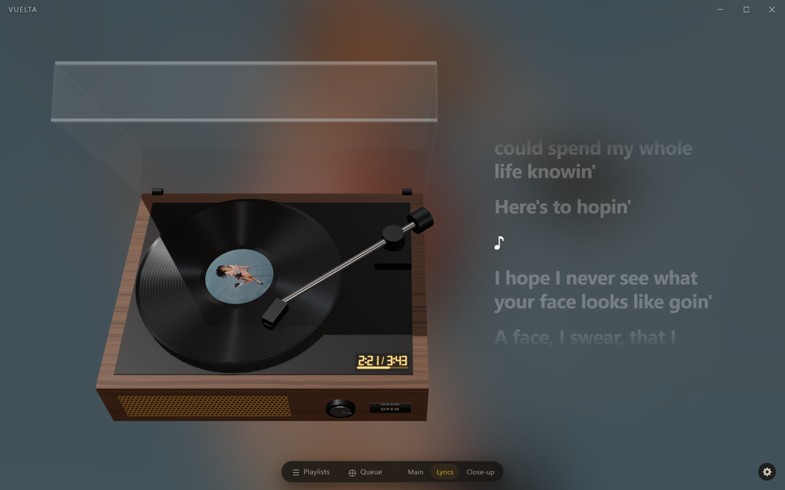
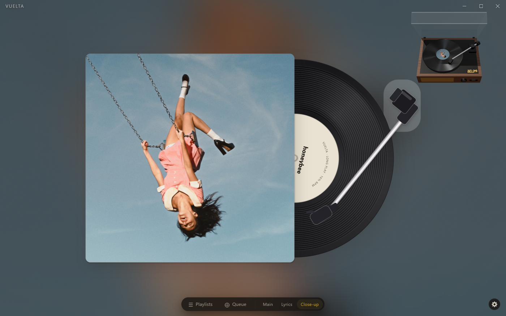
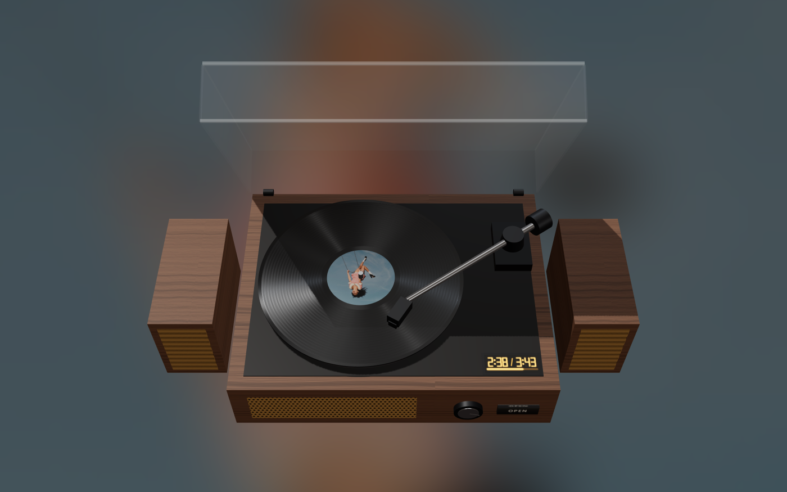
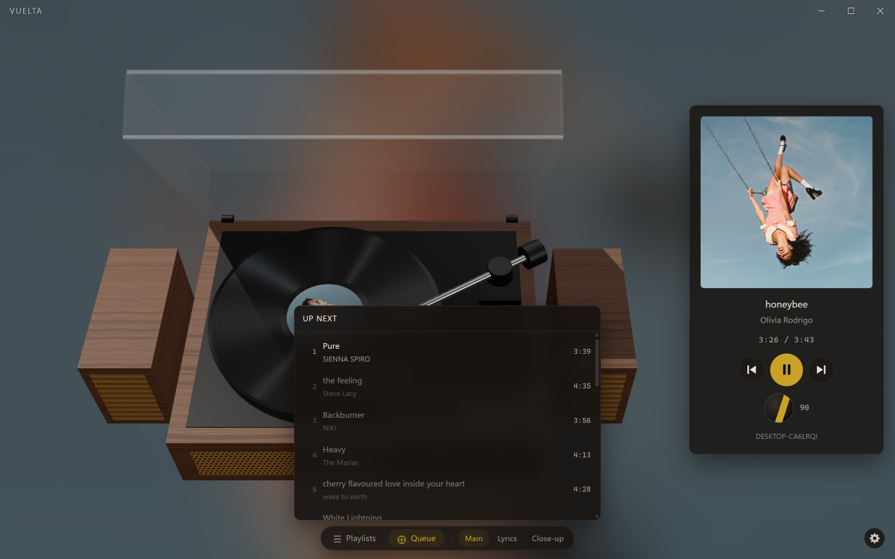
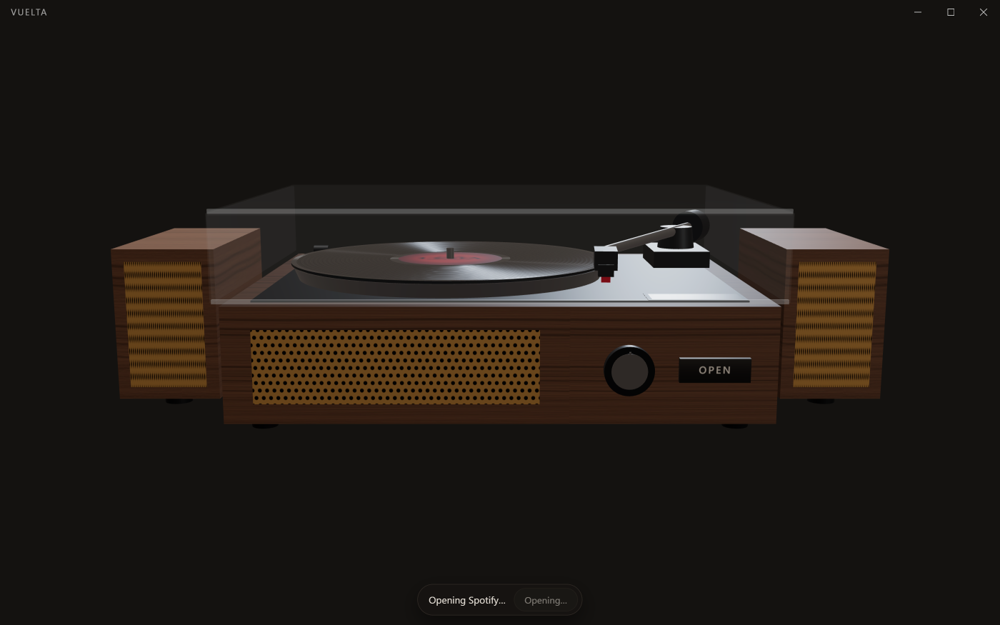

<div align="center">



# Vuelta

**A desktop turntable that mirrors your Spotify playback.**

Your music, as a record you can actually touch — drop the needle, drag the tonearm,
close the lid to stop.

</div>

<p align="center">
  
</p>

---

## What it is

Vuelta renders a virtual record player on your desktop. Whatever is playing in Spotify appears as a
spinning record with the album art as its centre label, and the tonearm tracks the song's progress
across the groove. You can pause by clicking the disc, scrub by dragging the arm, and skip by
pushing the record sideways like a card off a stack.

> **Vuelta does not play audio.** It is a remote control. The Spotify desktop client remains the
> actual playback device — Vuelta sends commands to Spotify's servers, which relay them to your
> client. Everything you see is a mirror of what Spotify is already doing.

**Name:** *Vuelta* — Spanish for a turn, a lap, or a return.

---

## Why I built this

Four reasons, in the order they occurred to me:

1. **I didn't want to pay for the alternatives.** The similar apps want money, and even a one-off
   "lifetime" price is still a price for something I could build myself.
2. **There is no vinyl app for desktop.** The ones that exist are phone widgets. Nothing sits on a
   real screen and behaves like an object on your desk.
3. **I like vinyl.** That is reason enough to want one on the machine I actually work at.
4. **Spotify on its own is boring.** A list of rows and a progress bar is a fine way to *operate*
   music and a dull way to *listen* to it. I wanted the part of playing a record that has nothing
   to do with efficiency — the lid, the platter, the needle finding the groove.

That last one is really the whole project. Everything else in here is in service of it.

---

## Features

### Three looks, switched with `1` `2` `3`

<table>
<tr>
<td width="50%"></td>
<td width="50%"></td>
</tr>
<tr>
<td><b>Main</b> — the whole machine with a bookshelf speaker either side, and a now-playing panel
carrying transport and volume.</td>
<td><b>Lyrics</b> — the bare deck beside a column of time-synced lyrics, one line lit at a time.
The speakers come off and the camera reframes for the narrower machine.</td>
</tr>
</table>

<p align="center">
  
</p>

**Close-up** — a different thing entirely: a sleeve and a record lying on a sheet of paper, seen
from overhead, with the machine shrunk to a preview in the corner. The record carries a *printed*
label — title, artist, `LONG PLAY · 16⅔ RPM`, a barcode — because the album art already lives on
the sleeve, and showing it twice in one frame breaks the illusion. Click the cover and it trades
places with the record in the stack.

### The interface gets out of the way

<p align="center">
  
</p>

Click the empty field and **everything** goes: the browser bar, the now-playing panel, the settings
gear, the window's own title and its minimise, maximise and close buttons. What is left is the
machine on a field made from the playing cover, blurred until only its colour survives. Click
again — or just reach for the top edge — to bring it back.

The window controls are drawn by the app rather than by Windows, specifically so they can leave
with everything else.

### Pick what goes on

<p align="center">
  
</p>

Your playlists and the live queue, from a bar that appears with the rest of the chrome. This is a
*chooser*, not a library browser — no search, no album or artist pages, no editing. Vuelta still
shows what Spotify is playing; it only lets you decide which record goes on.

### It fetches the deck for you

<p align="center">
  
</p>

Open Vuelta with Spotify closed and it opens Spotify, waits for it to register, makes it the
active device, **opens the lid, and then starts the music** — in that order, so the first note
lands on an open deck rather than a closed one. Measured from cold with Spotify quit: deck on
screen at 1.1s, playing by 10.2s.

**The waiting state is the machine, not a page.** Above is what you see while that happens: the
deck sitting there with its lid shut, and the message in a strip along the bottom where the browser
bar will be. It used to be a page of text, which made an ordinary wait look like an error and hid
the one thing worth watching — and because that page deferred mounting the 3D canvas, the lid's
travel happened behind a blank window. With the machine up throughout, the scene is long since
drawn by the time a device appears, so the lid opening is simply *seen*.

It does this once per launch and never again. "No device, so launch it" as a standing rule would
turn closing Spotify into a fight you could only win by quitting Vuelta first.

### Things that behave like the real object

| | |
|---|---|
| **Click the disc** | Play / pause |
| **Drag the disc sideways** | Skip — left for next, right for previous, like pushing a card off a stack |
| **Drag the tonearm** | Scrub. Commits on release only, never mid-drag |
| **Click the arm's housing** | Play / pause — where a cue lever would be |
| **Open the lid** | Nothing. It is mechanical; the machine just waits |
| **Close the lid** | Stops playback and parks the arm. This is the stop gesture — there is no stop button, because Spotify has no stop endpoint |
| **Click and slide the volume knob** | Volume, horizontally. The scroll wheel works while you are over it |
| **Click the empty field** | Show or hide all chrome |
| **<kbd>1</kbd> <kbd>2</kbd> <kbd>3</kbd>** | Main / Lyrics / Close-up |

The platter turns at **16⅔ rpm** — one revolution every 3.6 seconds. A real LP turns once every
1.8s, which is accurate and reads as hurried. This is deliberately half of life.

---

## Install

### Requirements

- **Windows 10 or 11**
- **Spotify Premium** — playback control is a Premium-only API
- The **Spotify desktop client** installed (Vuelta will launch it for you)
- Your own **Spotify Client ID** — free, about two minutes, explained below

### Build and install

There is no published download — this is a personal build. Produce the installer yourself:

```bash
corepack enable      # once per machine: pins npm to the version in package.json
npm ci               # exact, reproducible restore
npm run dist         # -> release/Vuelta-0.1.0-setup.exe
```

Then run `release/Vuelta-0.1.0-setup.exe`. It installs for your user only, so it needs no
administrator prompt, and it appears in **Settings ▸ Apps** for a clean uninstall. Settings live in
`%APPDATA%\Vuelta` and survive uninstalling, so reinstalling does not ask for the Client ID again.

> **Windows SmartScreen will warn you**, because the installer is unsigned — a code signing
> certificate costs hundreds a year and is not worth it here. Click **More info → Run anyway**.

`npm run dev` runs it from source without installing anything.

### First run: your own Client ID

Spotify caps a development-mode app at five authorized users, and since May 2025 they only accept
extended-quota applications from organizations. So rather than ship an app that can serve five
people in total, Vuelta asks each user to register their own — every install becomes its own app
with exactly one authorized user, and the cap never binds.

The first screen walks you through it:

1. Go to the [Spotify Developer Dashboard](https://developer.spotify.com/dashboard) and **Create
   an app**. Any name will do; tick **Web API**.
2. Add this **exact** redirect URI — copy it from Vuelta's setup screen rather than typing it:

   ```
   http://127.0.0.1:8888/callback
   ```

3. Under **User Management**, add the email address of the Spotify account you will be listening
   with. **This is the easiest step to miss**, and skipping it makes every request fail with a 403.
   Vuelta detects that case specifically and tells you the fix instead of showing a raw error.
4. Copy the **Client ID** from your app's settings and paste it into Vuelta.

You sign in through your real browser, on Spotify's own domain. Vuelta never shows a Spotify login
form and never sees your password.

---

## Development

```bash
npm run dev          # Electron + Vite with HMR
npm run verify       # env check -> security check -> typecheck -> lint -> test
npm run dist:dir     # a runnable packaged build, without the installer step
```

`dist:dir` matters more than it looks. It skips the installer step but still produces a *packaged*
executable, which is the only way to exercise the paths that exist solely when packaged — notably
the Content-Security-Policy, which is switched off entirely in development.

### Scripts

| Script | Does |
| --- | --- |
| `npm run dev` | Electron + Vite with HMR |
| `npm run build` | Bundle main, preload and renderer into `out/` |
| `npm run dist` | Build the Windows installer into `release/` |
| `npm run typecheck` | `tsc --build` across all layer projects |
| `npm run lint` | ESLint, including the layer-boundary rules |
| `npm test` | Vitest over `core/` |
| `npm run verify` | env check → security check → typecheck → lint → test |

### Environment

Node has no `virtualenv`. `node_modules/` gives dependency isolation for free, but nothing pins the
interpreter, the package manager, or exact versions. This project pins all three.

| Python | Vuelta |
| --- | --- |
| `python -m venv` (pinned interpreter) | `.node-version` + `engines.node` + `engine-strict` |
| `pip` pinned inside the venv | `packageManager` field, enforced by Corepack |
| `site-packages/` isolation | `node_modules/` (already per-project) |
| `requirements.txt` | `save-exact=true` + committed `package-lock.json` |
| `pip install -r requirements.txt` | `npm ci` |

`npm run env:check` prints a status table and exits non-zero if anything has drifted.

**Two version pins are load-bearing.** Installing "latest everything" produces a broken tree: Vite
is held at 7 because `electron-vite@5` peers on ≤7 (which in turn holds `@vitejs/plugin-react` at
5.x), and TypeScript is held at 6.0.3 because `typescript-eslint` requires `<6.1.0` — and
type-aware linting is what enforces the layer boundaries below.

---

## How it is built

### Layers

```
src/skins/   receives only RenderState + Actions. No fetch, no tokens, no Spotify awareness.
src/views/   composes skins into the three looks.
src/app/     screens and the React shell.
src/core/    store, state machine, contract.       <- no React, no DOM, no Node
src/main/    PKCE auth, token storage, API client. <- the only layer that knows Spotify exists
```

The governing principle: **the thing that knows about Spotify and the thing that draws a turntable
must never know about each other.** That is what makes a future renderer a swap rather than a
rewrite — and it is why the close-up could be rebuilt from a 3D scene into DOM and SVG without
touching a line of playback code.

### The boundaries are enforced, not just documented

Two independent mechanisms, because a rule nothing checks is a rule that decays:

1. **The compiler.** `tsconfig.core.json` gives `core/` neither the `DOM` lib nor Node types, so
   `document`, `window` and `process` do not exist there.
2. **The linter.** `eslint.config.mjs` declares per-directory import zones — `core/` may not import
   React or Electron; `skins/` may not import from `main/`; the renderer may not import from
   `main/` at all, only through the preload bridge.

To confirm they are live, add `import React from 'react'` to any file in `src/core/` and run
`npm run lint`. It fails, with an explanation.

### Two animation strategies, deliberately not merged

Continuous values — the arm's angle, the platter's rotation, playback progress — run on a
hand-written `requestAnimationFrame` loop that writes `transform` straight to refs. **Nothing that
animates lives in React state**, because re-rendering a turntable sixty times a second stutters.
Discrete sequences like the lid and the record swap use a timeline instead.

### Keeping time without a clock

Spotify is polled every 3–5 seconds, which is far too slow to drive a second hand. Between polls
the progress is extrapolated locally, then *eased* back toward the truth when the next poll lands
rather than snapped — unless the drift exceeds about two seconds, where snapping is the lesser
evil.

Every user action writes an **optimistic override** with a short TTL, and contradicting poll data
is discarded while it lives. Without that, an in-flight poll lands just after your click and the
interface jumps backwards.

### Security

`contextIsolation: true`, `nodeIntegration: false`, `sandbox: true` — verified by a check that
fails the build if any of them regress. The renderer's entire view of the outside world is the
`VueltaBridge` type in `src/core/contract.ts`.

Authorization is **Authorization Code with PKCE** — no client secret, because a desktop binary
cannot keep one. Access and refresh tokens never leave the main process. The refresh token is
encrypted with Electron `safeStorage` (DPAPI) and, if secure storage is unavailable, is **not
persisted at all** rather than written in plain text.

See [SECURITY.md](SECURITY.md) for the full posture, including exactly what leaves the machine.

---

## Limits worth knowing

These are Spotify's constraints, not oversights:

- **Premium is required.** Playback control is a Premium-only API.
- **Spotify must be running.** It is the playback device; Vuelta is the remote.
- **Nothing is beat-synced.** `audio-features` and `audio-analysis` return 403 for apps created
  after November 2024, so there is no BPM and no beat grid. A speaker that pulsed with the music
  would be inventing it, which is why Vuelta's do not move.
- **Lyrics do not come from Spotify.** Their Web API has no lyrics endpoint. Vuelta uses
  [LRCLIB](https://lrclib.net) — free, keyless, time-synced — and only while the lyrics view is
  open. Nothing is sent in the other two looks.
- **Album art is centre-cropped** to fit a circular label. Fine for personal use; read Spotify's
  design guidelines before redistributing anything.

---

## Status

**M7.** The frameless window, the no-device state and the packaged installer are done. A tray icon
and an always-on-top toggle are what remain.

| | Milestone | |
| --- | --- | --- |
| M0 | Electron shell, Client ID setup, PKCE auth | ✅ |
| M1 | Polling, local extrapolation, reconciliation, optimistic overrides | ✅ |
| M2 | Disc spins, album art label, tonearm sweeps | ✅ |
| M3 | Disc click plays/pauses; arm drags to scrub | ✅ |
| M4 | Lid opens and closes; the launch sequence works | ✅ |
| M5 | Front panel, controls, volume knob | ✅ |
| M6 | Record-swap animation on the track boundary via queue pre-fetch | ✅ |
| M7 | Frameless window, no-device state, packaged installer | ◐ |

Auth came first, before a single pixel of turntable, because it is the only part of this project
that could fail in a way you cannot design around.

---

## Licence

MIT. Not affiliated with Spotify. Spotify is a trademark of Spotify AB.
